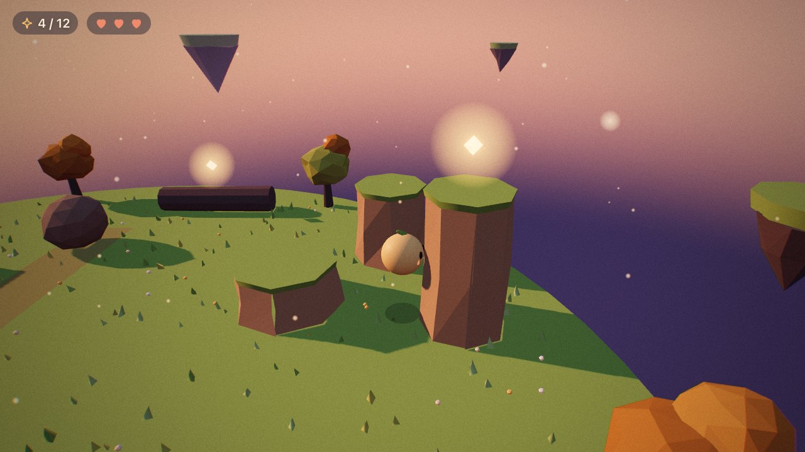

# Film

Shot on film: fine grain, darker corners, a gentle curve, tinted shadows and highlights.

Put it on: `node tools/looks/apply.mjs film` &nbsp; Take it off: `node tools/looks/apply.mjs none`

It is a pass over the finished picture, so it works on any starter game without touching the game's code. Text and buttons are not part of the picture and stay as they are.

## What it does

- Fine grain, re-rolled 24 times a second.
- A gentle film curve, slightly thinner colour, softly darker corners.
- Faded blacks that lean to the palette's shadow colour; highlights that lean to its light colour.
- A soft halo round the very brightest things, and a trace of colour fringing at the frame edges.

## Colours

Shadows are tinted with the palette's `shadow`, highlights with its `light`.

## How it is made

Self-contained pass (no block).

## Options (press ` in the game, group "Look")

| Option | Starts at | Range | What it does |
|---|---|---|---|
| Grain (`grain`) | 0.05 | 0 to 0.2 |  |
| Dark corners (`vignette`) | 0.35 | 0 to 1 |  |
| Faded blacks (`fade`) | 0.35 | 0 to 1 | Lifts the darkest tones and tints them with the palette shadow colour. |
| Tinted highlights (`warmth`) | 0.4 | 0 to 1 | Leans the bright tones toward the palette light colour. |
| Contrast (`contrast`) | 0.35 | 0 to 1 | Strength of the film curve. |
| Glow (`glow`) | 0.3 | 0 to 1 | A soft halo round the brightest things. |
| Edge fringing (`fringe`) | 0.5 | 0 to 2 | Colour splitting toward the frame edges, like a real lens. |

Start with other values: `node tools/looks/apply.mjs film --set grain=...`, or in a vibe: `"look": { "id": "film", "options": { ... } }`.

## Cost

Rated **light**. Measured at 1280x720 in the kit's hidden test browser (2026-11-14), with the bot playing and every frame read back from the graphics chip: on the island starter a whole frame took 6.6 ms with the look and 2.8 ms without; on the platformer starter 5.8 ms and 3 ms. Both held 60 frames a second (the screen's limit), so there is plenty of room. The test laptop was busy with other work (load about 5), so single milliseconds mean little. Measure again with `node tools/looks/shots.mjs film --no-save`.

## Good to know

- Flat 2D games (an orthographic camera): Checked on the platformer starter.
- It grades the picture; it does not make the rendering more real. Real photographic rendering is the block `meticulai-photoreal`, which needs the game built for it.

## The fuller version

The block `meticulai-photoreal` gives real photographic rendering: one real sky lighting everything, soft shadows, reflections, depth of field, auto exposure. It needs scanned assets, a sky image, its own lights and two extra npm packages; the film look only grades the picture. See `blocks/vendor/meticulai-photoreal/HOW-TO-USE.md`.
