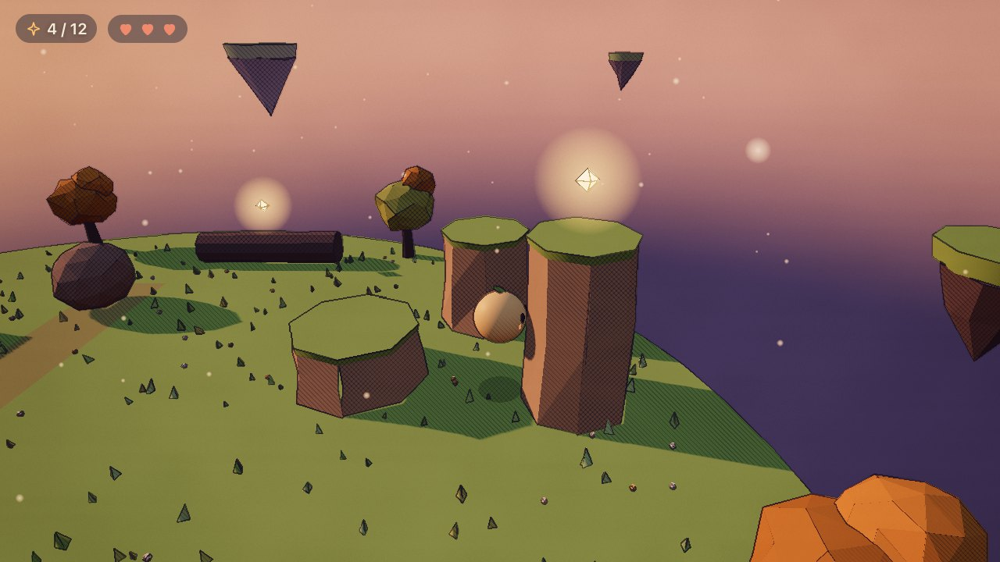

# Ink

A pen-and-ink drawing on paper: boiling outlines and hatching in the shadows.

Put it on: `node tools/looks/apply.mjs ink` &nbsp; Take it off: `node tools/looks/apply.mjs none`

It is a pass over the finished picture, so it works on any starter game without touching the game's code. Text and buttons are not part of the picture and stay as they are.

## What it does

- Outlines wherever depth or the facing of a surface breaks, with uneven pen pressure.
- The lines "boil": they are redrawn seven times a second, like hand-drawn animation.
- Hatching in the shadows, cross-hatching in deep shadow.
- Paper grain, a little paper warmth in the highlights, softly darker corners.

## Colours

The ink is a dark version of the palette's `shadow`; the paper tint a pale version of `light`.

## How it is made

Uses the block `meticulai-ink-illustration`: its real post pass (`createInkPost`). The block draws light values; one small extra pass turns them into screen colours the way the starter does.

## Options (press ` in the game, group "Look")

| Option | Starts at | Range | What it does |
|---|---|---|---|
| Lines (`lines`) | 0.92 | 0 to 1 | How strongly outlines are inked. |
| Hatching (`hatching`) | 1 | 0 to 2 | Pen strokes in the shadows. 0 = none. |
| Hatch from (`hatchFrom`) | 0.15 | 0.02 to 0.5 | How dark a place must be before it gets hatched. Higher = more hatching. |
| Line wobble (`wobble`) | 2.6 | 0 to 6 | How much the lines shake, in pixels. 0 = still, ruled lines. |
| Paper tint (`paper`) | 0.18 | 0 to 0.6 | How much the paper colour soaks into the picture. |
| Paper grain (`grain`) | 1 | 0 to 2 |  |
| Dark corners (`vignette`) | 0.2 | 0 to 0.6 |  |

Start with other values: `node tools/looks/apply.mjs ink --set lines=...`, or in a vibe: `"look": { "id": "ink", "options": { ... } }`.

## Cost

Rated **medium**. Measured at 1280x720 in the kit's hidden test browser (2026-11-14), with the bot playing and every frame read back from the graphics chip: on the island starter a whole frame took 6.2 ms with the look and 2.8 ms without; on the platformer starter 5.4 ms and 3 ms. Both held 60 frames a second (the screen's limit), so there is plenty of room. The test laptop was busy with other work (load about 5), so single milliseconds mean little. Measure again with `node tools/looks/shots.mjs ink --no-save`.

## Good to know

- The scene is drawn twice a frame (colours, then facing), so heavy scenes pay twice.
- Glows, sparks and other see-through things get no outline (on purpose).
- Flat 2D games (an orthographic camera): checked on the platformer starter; outlines and paper work, lines do not thin with distance there.
- On very dark palettes dark ink barely shows.

## The fuller version

The block `meticulai-ink-illustration` gives three-tone toon materials, ink bleeding in when hurt, and colour sets that cross-fade between levels or times of day. The ink look already uses its line and hatching pass; the rest is materials and game events. See `blocks/vendor/meticulai-ink-illustration/HOW-TO-USE.md`.
