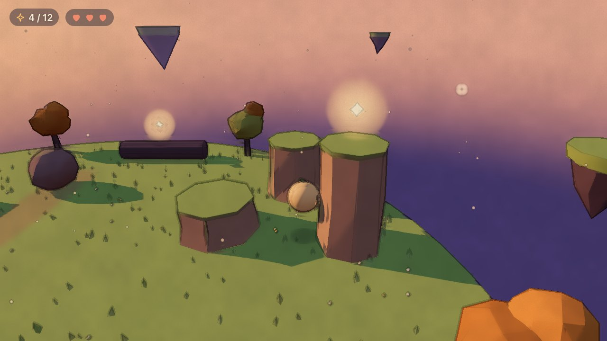

# Painterly

A gouache painting: broad brush strokes near, fine ones far, paper tooth.

Put it on: `node tools/looks/apply.mjs painterly` &nbsp; Take it off: `node tools/looks/apply.mjs none`

It is a pass over the finished picture, so it works on any starter game without touching the game's code. Text and buttons are not part of the picture and stay as they are.

## What it does

- A brush that paints near things in broad strokes and far things finely (a Kuwahara filter sized by distance).
- A little more pigment at the edge of each stroke, paint pooled unevenly, paper tooth.
- Soft dark edges where one thing stands in front of another (a darker shade of the colour, not black).
- Warm lights, cool darks, and whites that never glare.

## Colours

The picture's own colours (so palette.json). The pass adds a slight warm/cool split of its own.

## How it is made

Uses the block `meticulai-painterly-styles`: its real finishing pass (`StylePass`, the "gouache" style), fed with the starter's own picture and depth.

## Options (press ` in the game, group "Look")

| Option | Starts at | Range | What it does |
|---|---|---|---|
| Brush size (`brush`) | 2.2 | 0.6 to 3 | Bigger = broader strokes and softer detail. |

Start with other values: `node tools/looks/apply.mjs painterly --set brush=...`, or in a vibe: `"look": { "id": "painterly", "options": { ... } }`.

## Cost

Rated **medium**. Measured at 1280x720 in the kit's hidden test browser (2026-11-14), with the bot playing and every frame read back from the graphics chip: on the island starter a whole frame took 7.6 ms with the look and 2.8 ms without; on the platformer starter 5.8 ms and 3 ms. Both held 60 frames a second (the screen's limit), so there is plenty of room. The test laptop was busy with other work (load about 5), so single milliseconds mean little. Measure again with `node tools/looks/shots.mjs painterly --no-save`.

## Good to know

- Flat 2D games (an orthographic camera): Checked on the platformer starter. The brush is one size over the whole picture there (it is sized by distance, and a flat game has one).
- Brush strokes live on the screen, not on the walls: fine when things are calm, a little swimmy in fast motion.
- Brush distances are in metres; in a game whose units are not roughly metres, tune "Brush size".
- Needs a perspective camera for the distance-sized brush and the edges.
- The block's other two styles (ink miniature, clean toon) use fixed colours of their own, so they are not offered as looks.

## The fuller version

The block `meticulai-painterly-styles` gives materials repainted in flat pigment, strokes that stay on the walls, a painted sky, and two more styles with a live switch. The painterly look uses its finishing brush; the rest patches every material and replaces the sky. See `blocks/vendor/meticulai-painterly-styles/HOW-TO-USE.md`.
