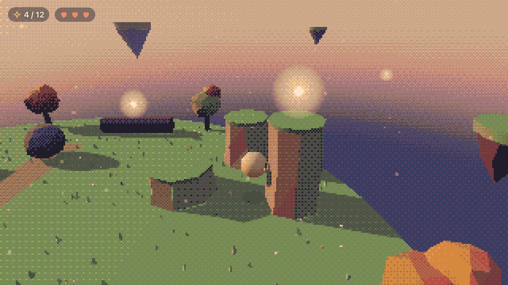

# Pixels

Big crisp pixels, snapped to colours from your palette with dither patterns.

Put it on: `node tools/looks/apply.mjs pixel` &nbsp; Take it off: `node tools/looks/apply.mjs none`

It is a pass over the finished picture, so it works on any starter game without touching the game's code. Text and buttons are not part of the picture and stay as they are.

## What it does

- The game is drawn 180 rows tall (you choose) and enlarged with square pixels that stay sharp at any window size.
- Every pixel is snapped to a short list of colours made from palette.json: each role in four shades, plus the sky and fog.
- A 4x4 dither pattern mixes neighbouring colours, so soft light still reads.
- With "Palette colours only" off, it uses plain colour steps instead.

## Colours

The colour list is built from every role in palette.json (base, accent, danger, player, shadow, light, sky, fog).

## How it is made

Self-contained passes. The ordered dither is the one in the block `meticulai-pixel-3d`; the block itself is not needed.

## Options (press ` in the game, group "Look")

| Option | Starts at | Range | What it does |
|---|---|---|---|
| Rows (`rows`) | 180 | 90 to 360 | How many pixel rows tall the picture is. Fewer = bigger pixels. |
| Palette colours only (`usePalette`) | true | on / off | Snap every pixel to colours made from palette.json. |
| Dither (`dither`) | 0.6 | 0 to 1.5 | Checker patterns between neighbouring colours. 0 = hard bands. |
| Colour steps (`levels`) | 12 | 2 to 32 | Used when "Palette colours only" is off: steps per colour channel. |

Start with other values: `node tools/looks/apply.mjs pixel --set rows=...`, or in a vibe: `"look": { "id": "pixel", "options": { ... } }`.

## Cost

Rated **light**. Measured at 1280x720 in the kit's hidden test browser (2026-11-14), with the bot playing and every frame read back from the graphics chip: on the island starter a whole frame took 3.5 ms with the look and 2.8 ms without; on the platformer starter 3.1 ms and 3 ms. Both held 60 frames a second (the screen's limit), so there is plenty of room. The test laptop was busy with other work (load about 5), so single milliseconds mean little. Measure again with `node tools/looks/shots.mjs pixel --no-save`.

## Good to know

- Flat 2D games (an orthographic camera): Checked on the platformer starter.
- Text and buttons stay sharp: they are not part of the picture.
- It is a filter over a 3D picture, so edges crawl a little when the camera moves. True pixel art (a camera that moves in whole pixels, hand-made ramps, sprites) is the full block.
- Colours outside the palette (a texture in its own colours, say) are pulled to the nearest palette colour.

## The fuller version

The block `meticulai-pixel-3d` gives true pixel art: a camera snapped to whole pixels, objects lit through hand-made colour ramps, sprites drawn in code. It needs its own orthographic camera, its own materials on every object and no tone mapping. See `blocks/vendor/meticulai-pixel-3d/HOW-TO-USE.md`.
