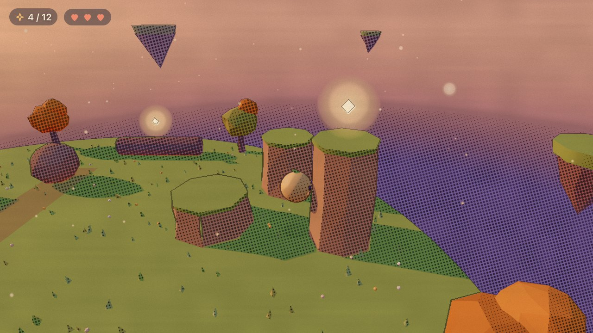

# Print (lite)

The picture printed on paper: flat colour, halftone dots for the shade, inked outlines.

Put it on: `node tools/looks/apply.mjs print-lite` &nbsp; Take it off: `node tools/looks/apply.mjs none`

It is a pass over the finished picture, so it works on any starter game without touching the game's code. Text and buttons are not part of the picture and stay as they are.

## What it does

- Shading is lifted out of the colours, so lit and shaded parts of a thing print in the same flat colour.
- What was in shade is printed as a screen of dots in one dark ink; the darker, the bigger the dots.
- Thin ink outlines where one thing stands in front of another.
- The ink plate sits a pixel or two off the colour plate, the ink is uneven, the paper has grain.

## Colours

Paper is a pale version of the palette's `light`; the ink is a dark version of `shadow`. Everything else is the game's own colours.

## How it is made

Self-contained pass. The halftone dot, the off-register ink plate and the uneven ink follow the block `meticulai-riso-print`; the block itself is not needed.

## Options (press ` in the game, group "Look")

| Option | Starts at | Range | What it does |
|---|---|---|---|
| Dot size (`dotSize`) | 6.5 | 3 to 14 | Size of the halftone dots, in pixels at 720p. |
| Ink (`ink`) | 0.85 | 0 to 1 | How dark the dots and lines print. |
| Flat colour (`flatten`) | 0.8 | 0 to 1 | How much shading is taken out of the colours and given to the dots. |
| Outlines (`lines`) | 0.7 | 0 to 1 | Inked outlines round things. 0 = none. |
| Misprint (`misprint`) | 1 | 0 to 4 | How far the ink plate sits off the colour plate. |
| Paper grain (`grain`) | 1 | 0 to 2 | Paper texture and uneven ink. |

Start with other values: `node tools/looks/apply.mjs print-lite --set dotSize=...`, or in a vibe: `"look": { "id": "print-lite", "options": { ... } }`.

## Cost

Rated **light**. Measured at 1280x720 in the kit's hidden test browser (2026-11-14), with the bot playing and every frame read back from the graphics chip: on the island starter a whole frame took 5.5 ms with the look and 2.8 ms without; on the platformer starter 5.3 ms and 3 ms. Both held 60 frames a second (the screen's limit), so there is plenty of room. The test laptop was busy with other work (load about 5), so single milliseconds mean little. Measure again with `node tools/looks/shots.mjs print-lite --no-save`.

## Good to know

- Flat 2D games (an orthographic camera): Checked on the platformer starter: outlines, dots and paper all work.
- It keeps the game's colours. It is NOT the three-spot-ink risograph: that is the full block.
- Very dark palettes leave little room for dots (the whole picture is "in shade"); lower "Flat colour" there.

## The fuller version

The block `meticulai-riso-print` gives the full risograph print: every object printed in its own spot ink by role, with ink sets and screen signals. Objects get ROLES instead of colours and are drawn into a special buffer; the game must ask for every material by role. See `blocks/vendor/meticulai-riso-print/HOW-TO-USE.md`.
