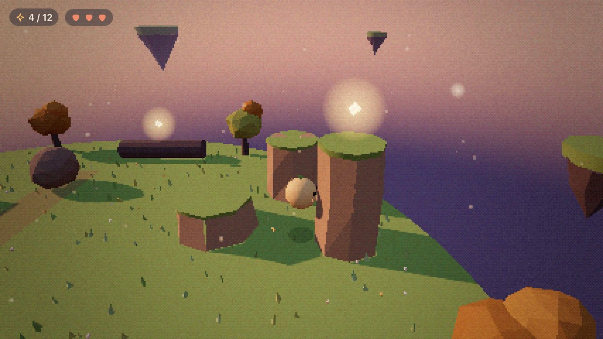

# Retro console

A mid-90s 3D console: low resolution, few colour steps, dither, wobbling corners.

Put it on: `node tools/looks/apply.mjs retro-console` &nbsp; Take it off: `node tools/looks/apply.mjs none`

It is a pass over the finished picture, so it works on any starter game without touching the game's code. Text and buttons are not part of the picture and stay as they are.

## What it does

- Drawn 240 rows tall and enlarged with hard pixels.
- 24 colour steps per channel with a 4x4 dither pattern, a little grain, darker corners.
- Wobble: corners of objects snap to the pixel grid, so shapes jitter slightly as they move, like the real machines.

## Colours

The picture's own colours (so palette.json), only stepped.

## How it is made

Uses the block `meticulai-ps1-look`: its real material patch for the wobble (`patchPS1Material`), and the dither, colour-step, grain and vignette maths of its post pass. The block's own pipeline is not used, because it has no tone mapping (the starter's light needs it) and a fixed horror grade.

## Options (press ` in the game, group "Look")

| Option | Starts at | Range | What it does |
|---|---|---|---|
| Rows (`rows`) | 240 | 120 to 480 | How many pixel rows tall the picture is (240 is the classic). |
| Colour steps (`levels`) | 24 | 4 to 64 | Steps per colour channel. Fewer = more banding and dither. |
| Dither (`dither`) | 1 | 0 to 2 | Strength of the 4x4 dither pattern. |
| Wobble (`wobble`) | true | on / off | Corners snap to the pixel grid, so shapes jitter as they move. |
| Grain (`grain`) | 0.04 | 0 to 0.2 |  |
| Dark corners (`vignette`) | 0.3 | 0 to 1 |  |

Start with other values: `node tools/looks/apply.mjs retro-console --set rows=...`, or in a vibe: `"look": { "id": "retro-console", "options": { ... } }`.

## Cost

Rated **light**. Measured at 1280x720 in the kit's hidden test browser (2026-11-14), with the bot playing and every frame read back from the graphics chip: on the island starter a whole frame took 3.8 ms with the look and 2.8 ms without; on the platformer starter 3.5 ms and 3 ms. Both held 60 frames a second (the screen's limit), so there is plenty of room. The test laptop was busy with other work (load about 5), so single milliseconds mean little. Measure again with `node tools/looks/shots.mjs retro-console --no-save`.

## Good to know

- Flat 2D games (an orthographic camera): Checked on the platformer starter.
- Wobble adds a few lines to the shaders of the game's ordinary materials as they appear (Standard, Lambert, Phong, Basic, Toon). Things with their own special shaders (the sky, particles) do not wobble. Switching Wobble off stops the movement; the added lines stay until the page reloads.
- Texture warping is off: it tears big flat surfaces unless models are cut into small pieces.
- The picture keeps the window's shape (no 4:3 black bars).

## The fuller version

The block `meticulai-ps1-look` gives the whole 90s console pipeline: warping textures on your models, 4:3 letterbox, eyes-closed, flash and dread effects. The retro-console look already uses its vertex wobble; the texture warp needs models cut into small pieces and its screen effects need game code to drive them. See `blocks/vendor/meticulai-ps1-look/HOW-TO-USE.md`.
