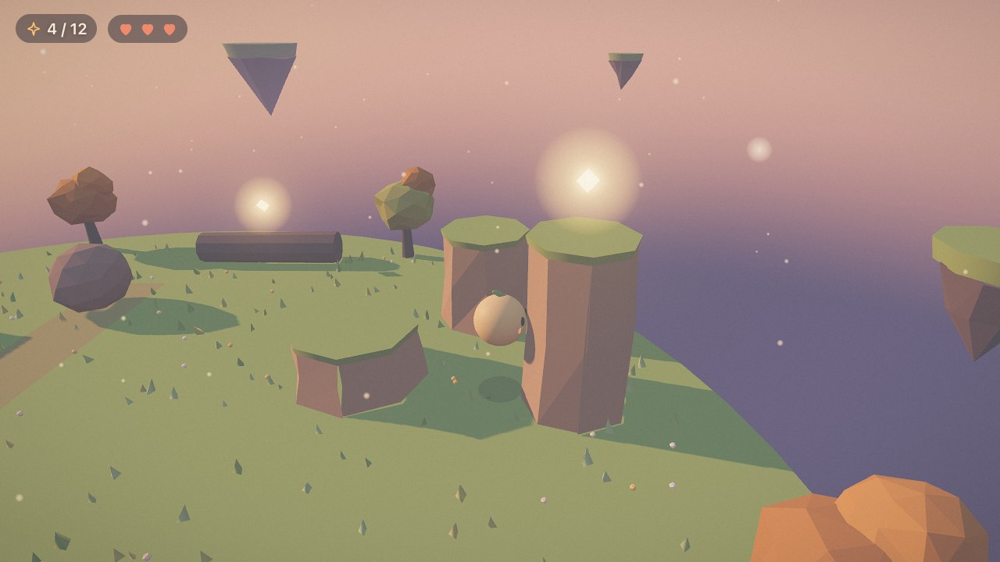

# Soft haze

Calm and airy: a faint glow, soft sun shafts, gentle contrast. Never glares.

Put it on: `node tools/looks/apply.mjs soft-haze` &nbsp; Take it off: `node tools/looks/apply.mjs none`

It is a pass over the finished picture, so it works on any starter game without touching the game's code. Text and buttons are not part of the picture and stay as they are.

## What it does

- A faint glow round bright things. Restrained on purpose: it never glares.
- Soft shafts of light when the sun is in or near the frame.
- Gentle contrast and slightly lifted shadows, a light sharpen, fine grain, softly darker corners.

## Colours

The picture's own colours (so palette.json). The sun's place for the shafts comes from palette.json too.

## How it is made

Uses the block `meticulai-haze`: its real final picture pipeline (`createHazePost`: faint bloom, sun shafts, the grade pass), set to the starter's own tone mapping so the palette's colours stay as chosen.

## Options (press ` in the game, group "Look")

| Option | Starts at | Range | What it does |
|---|---|---|---|
| Glow (`glow`) | 0.55 | 0 to 1 | The halo round bright things. Keep it low: this look is restrained on purpose. |
| Glow from (`glowFrom`) | 0.75 | 0.4 to 3 | How bright something must be before it glows. Lower = more of the picture glows. |
| Sun shafts (`shafts`) | 0.2 | 0 to 0.6 | Soft rays when the sun is in or near the frame. |
| Softness (`softness`) | 0.6 | 0 to 1 | Lower contrast and lifted shadows. 0 = crisp. |
| Grain (`grain`) | 0.02 | 0 to 0.1 |  |
| Dark corners (`vignette`) | 0.3 | 0 to 1 |  |

Start with other values: `node tools/looks/apply.mjs soft-haze --set glow=...`, or in a vibe: `"look": { "id": "soft-haze", "options": { ... } }`.

## Cost

Rated **medium**. Measured at 1280x720 in the kit's hidden test browser (2026-11-14), with the bot playing and every frame read back from the graphics chip: on the island starter a whole frame took 6.1 ms with the look and 2.8 ms without; on the platformer starter 5.4 ms and 3 ms. Both held 60 frames a second (the screen's limit), so there is plenty of room. The test laptop was busy with other work (load about 5), so single milliseconds mean little. Measure again with `node tools/looks/shots.mjs soft-haze --no-save`.

## Good to know

- Flat 2D games (an orthographic camera): Checked on the platformer starter.
- This is the block's finishing, not its air. The haze itself (far things fading into a sun-tinted mist) is the full block; the starter's own fog (`fogAmount` in palette.json) is the simple version and works with this look.
- While it is on, the renderer's tone mapping is switched off (the pass does it). It goes back when the look is removed.

## The fuller version

The block `meticulai-haze` gives the haze itself in the air of the world, a sky that melts into it, cloud shadows and a matching light rig. The soft-haze look uses its final grade; the air replaces the starter's fog and sky, which is a change to the world. See `blocks/vendor/meticulai-haze/HOW-TO-USE.md`.
