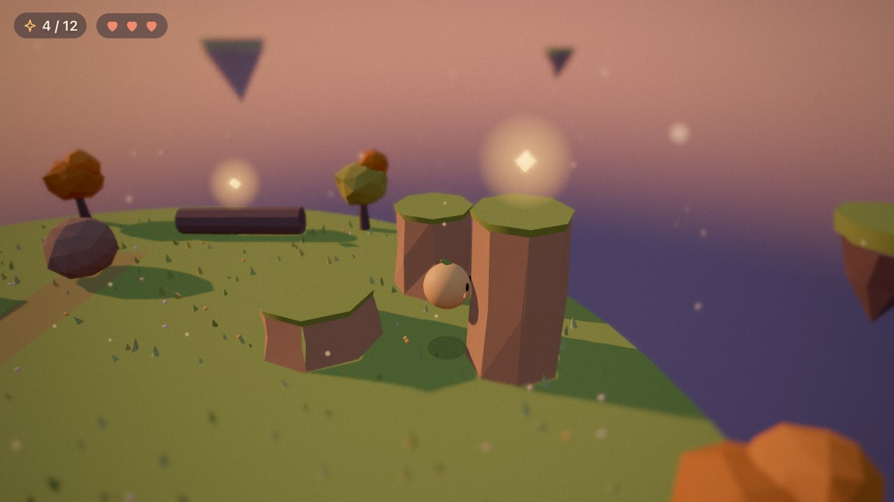

# Toy (tilt-shift)

A photographed miniature: one sharp band, the rest melting into soft blur.

Put it on: `node tools/looks/apply.mjs toy-tilt-shift` &nbsp; Take it off: `node tools/looks/apply.mjs none`

It is a pass over the finished picture, so it works on any starter game without touching the game's code. Text and buttons are not part of the picture and stay as they are.

## What it does

- A sharp band across the frame; above and below it the picture melts into soft, round blur.
- It focuses by itself: a few times a second it reads how far away the thing in the middle of the band is.
- A filmic grade with a little more colour, a faint glow on bright things, grain, darker corners, a trace of lens fringing.

## Colours

The picture's own colours (so palette.json), through the block's own tone mapping (AgX), which is a touch softer than the plain starter's. The block also warms the picture slightly.

## How it is made

Uses the block `meticulai-tilt-shift-macro`: its real lens (`TiltShiftLens`) at "medium" quality (half-resolution blur, faint bloom, no ambient occlusion), with automatic quality changes switched off.

## Options (press ` in the game, group "Look")

| Option | Starts at | Range | What it does |
|---|---|---|---|
| Blur (`blur`) | 1.2 | 0 to 2 | How strongly the top and bottom of the picture melt away. 0 = off. |
| Sharp band height (`band`) | -0.15 | -0.8 to 0.8 | Where the sharp band sits: -1 bottom of the screen, 0 middle, 1 top. |
| Sharp band width (`bandWidth`) | 0.16 | 0.04 to 0.6 |  |
| Depth blur (`depthBlur`) | 0.6 | 0 to 4 | Extra blur for things nearer or further than the focus. |
| Grain (`grain`) | 0.03 | 0 to 0.12 |  |
| Dark corners (`vignette`) | 0.5 | 0 to 1 |  |

Start with other values: `node tools/looks/apply.mjs toy-tilt-shift --set blur=...`, or in a vibe: `"look": { "id": "toy-tilt-shift", "options": { ... } }`.

## Cost

Rated **medium**. Measured at 1280x720 in the kit's hidden test browser (2026-11-14), with the bot playing and every frame read back from the graphics chip: on the island starter a whole frame took 8.3 ms with the look and 2.8 ms without; on the platformer starter 7.9 ms and 3 ms. Both held 60 frames a second (the screen's limit), so there is plenty of room. The test laptop was busy with other work (load about 5), so single milliseconds mean little. Measure again with `node tools/looks/shots.mjs toy-tilt-shift --no-save`.

## Good to know

- While it is on, the game draws at most 1.25 pixels per screen pixel and the renderer's tone mapping is switched off (the lens does it). Both go back when the look is removed.
- Blur hides things at the top and bottom of the screen: wrong for games where threats come from there. Lower "Blur" or move the band.
- Flat 2D games (an orthographic camera, like the platformer starter): only the band blur works. There is no depth to blur by, so the look switches "Depth blur" off there; checked on the platformer starter.

## The fuller version

The block `meticulai-tilt-shift-macro` gives focus on your own subject, camera shots (flyover, podium, diorama), ambient occlusion and a night grade. The toy look already uses its lens; the rest needs the game to say what to focus on and when. See `blocks/vendor/meticulai-tilt-shift-macro/HOW-TO-USE.md`.
